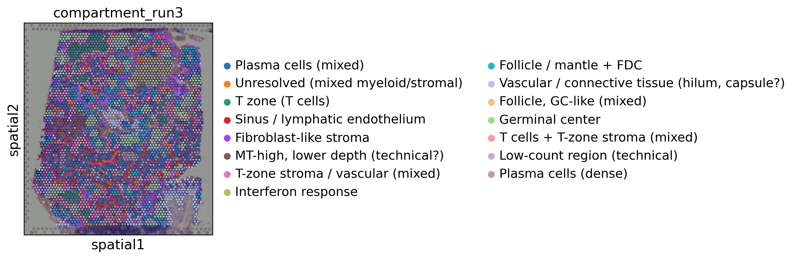
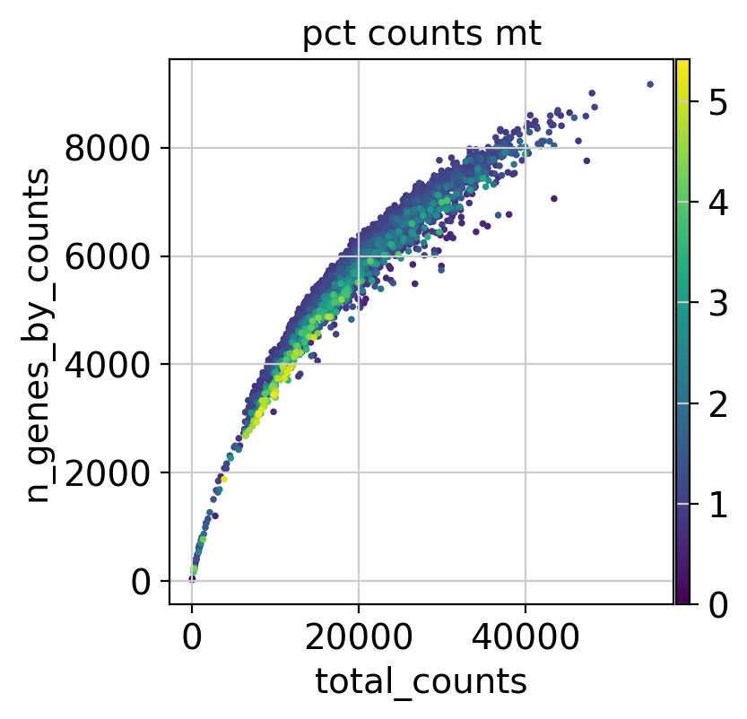
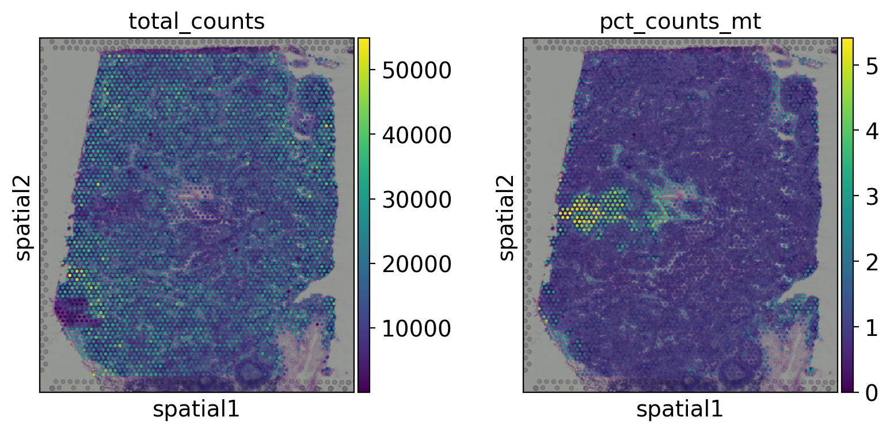
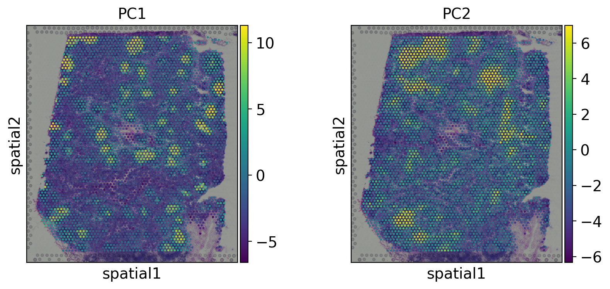
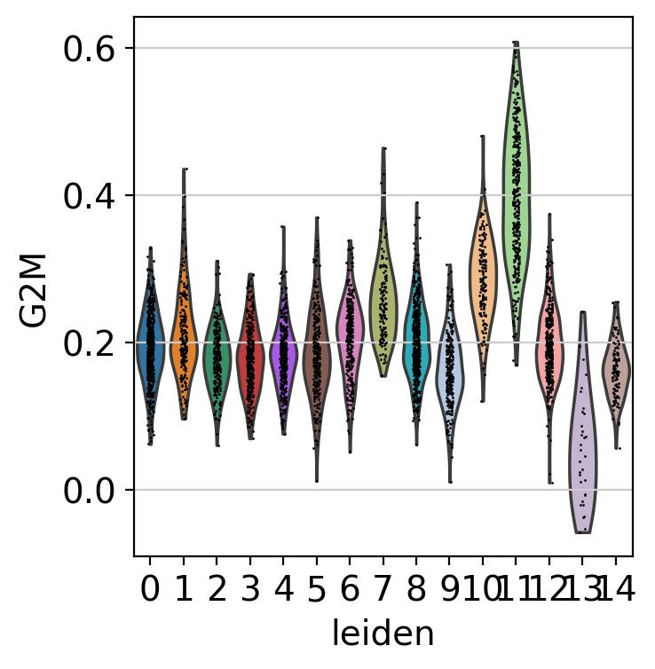
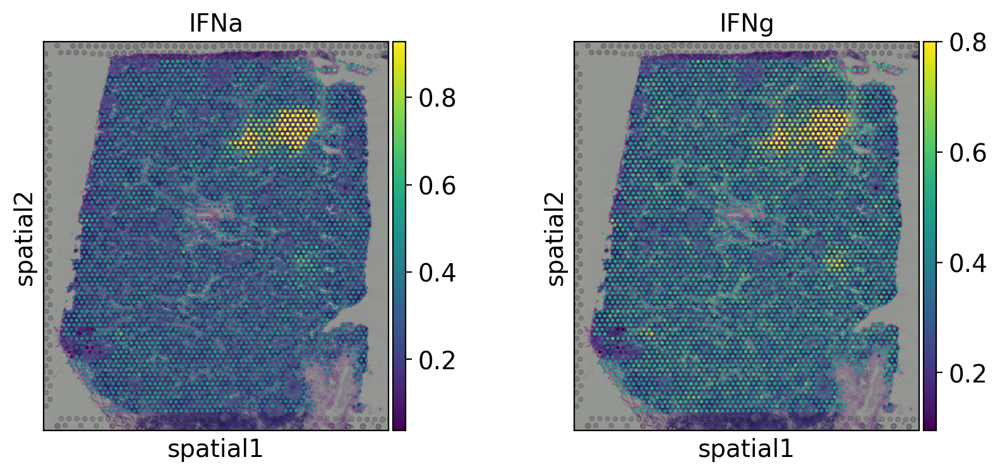

# Spatial transcriptomics of a human lymph node (10x Visium V1)

Exploratory analysis of a public 10x Genomics Visium section of human lymph node in Python (Scanpy). The project asks whether unsupervised analysis recovers known lymph node compartments, and checks each step for technical confounding (sequencing depth, mitochondrial content) and against independent gene sets.



*Final cluster labels (15 Leiden clusters) on the tissue. Labels are provisional; see the [Annotation](#annotation) table below.*

## Summary

- **Clean data.** Tight depth-vs-genes curve, mitochondrial (MT) fraction below ~5%. Only 2 spots removed by the `min_genes=100` filter.
- **Top PCs are biological.** PC1 and PC2 show no depth or MT gradient. PC1 separates follicle/germinal-centre genes from immunoglobulin, complement and stromal genes; PC2 separates T-cell genes from immunoglobulin, follicular dendritic cell (FDC) and stromal genes.
- **15 clusters, annotated from marker genes.** Core compartments are plasma cells, T zone, sinus/lymphatic endothelium, follicle/mantle with FDC genes, germinal centre, and stroma. Two clusters (291 spots, ~7%) are flagged technical from their QC values.
- **Germinal centre cluster is proliferative.** Highest G2/M score (mean 0.40 vs 0.29 in the adjacent follicle cluster and 0.16 to 0.21 in most others), with an AUC of 0.97 vs all other spots and 0.86 vs the adjacent follicle cluster. Preranked GSEA shows E2F targets, G2-M checkpoint and Myc targets enriched.
- **A distinct interferon-response cluster.** Interferon alpha response is the top GSEA term for cluster 7 and the Hallmark interferon scores are clearly highest there (mean IFNa 0.85 vs 0.34 to 0.47 in the other biological clusters). The cause cannot be determined from one section.

## Dataset

- 10x Genomics Visium V1 (Spatial 3' v1, Space Ranger 1.1.0), **Human Lymph Node**, loaded with `sc.datasets.visium_sge(sample_id="V1_Human_Lymph_Node")`.
- 4,035 spots × 36,601 genes (GRCh38). Each spot is 55 µm and mixes roughly 1 to 10 cells, so spots are not single cells.

## Approach and what is mine

The pipeline follows the standard Scanpy spatial workflow ([Scanpy tutorials](https://scanpy.scverse.org/en/stable/tutorials/index.html)). My additions:

- QC interpretation, including the spatial check of the MT-high and low-count regions.
- Checking that the top PCs are not technical, and interpreting them through gene loadings and spatial maps.
- A robustness comparison: an earlier run gave 13 clusters and the final run gave 15. The core compartments and the germinal-centre and interferon results were reproduced; finer splits were not.
- Marker-based annotation, with per-cluster depth and MT used to flag technical clusters.
- Pathway enrichment (preranked GSEA) and gene-set scoring (G2/M, interferon).

## Methods

| Step | Setting |
|---|---|
| Spot filter | `min_genes=100` (4,035 → 4,033 spots) |
| Gene filter | `min_cells=3` (36,601 → 22,411 genes) |
| Normalisation | `normalize_total`, `log1p`; raw counts kept in `layers["counts"]` |
| Highly variable genes | `n_top_genes=2000` |
| PCA | default; elbow at ~5 to 10 PCs |
| Neighbors | `n_pcs=10`, `random_state=42` |
| UMAP | `random_state=42` (display only) |
| Clustering | Leiden, `flavor="igraph"`, `n_iterations=3`, resolution 1.0 (default), `random_state=42` → 15 clusters |
| Markers | `rank_genes_groups`, Wilcoxon, one cluster vs rest |
| GSEA | `gseapy.prerank`, MSigDB Hallmark 2020, ranked by Wilcoxon score, `seed=0` |
| Scoring | `sc.tl.score_genes` with Hallmark G2-M, interferon alpha and gamma sets |

No doublet detection was applied: Visium spots are multi-cell by design. No MT or upper-count cutoff was applied because the distributions showed no outlier population.

## Results

### Quality control



The curve is tight and saturating, with MT below ~5% throughout. Higher-MT spots sit on the lower edge of the curve at 5 to 20k counts. On the tissue, higher-MT spots form localised groups instead of a diffuse pattern.



This plot cannot show tissue folds, edge artifacts or ambient RNA. The cause of the MT-high region is unresolved: a local capture or tissue effect and an MT-rich cell population both fit.

### Principal components



PC1 and PC2 show spatial structure and no depth or MT gradient. The positive end of PC1 is led by follicle and germinal-centre genes (*CR2*, *FDCSP*, *SERPINE2*, *MEF2B*, *RGS13*, *CXCL13*); the negative end by immunoglobulin genes (*IGHG1*, *IGHG2*, *IGKC*), complement genes (*C1QA*, *C1QB*) and stromal chemokines (*CCL2*, *CCL21*). The positive end of PC2 is led by T-cell genes (*TCF7*, *TRAC*, *IL7R*, *CCR7*, *CD3E*); the negative end by immunoglobulin, FDC and stromal genes (*IGHG4*, *CXCL13*, *CEMIP*, *TIMP3*).

### Annotation

Labels come from matching top markers to known lymph node compartments in the literature, and from per-cluster depth and MT. They are **provisional and have not been reviewed by a pathologist or immunologist.** Tissue anatomy was not interpreted.

| Cluster | Label | Key markers | Confidence |
|---|---|---|---|
| 0, 14 | Plasma cells (mixed / dense) | *IGHG1*, *IGKC*, *XBP1*, *JCHAIN*, *MZB1* | high |
| 2, 12 | T zone (12 more stroma-rich) | *TRAC*, *TRBC1/2*, *CCL19*, *CD3E*, *CCR7* | high |
| 3 | Sinus / lymphatic endothelium | *CLEC4M*, *CD209*, *LYVE1*, *STAB1*, *MARCO* | high |
| 4 | Fibroblast-like stroma | *CCL20*, *SERPINE1*, *CHI3L1*, *IGFBP7* | medium |
| 6 | T-zone stroma / vascular (mixed) | *CCL21*, *SPARCL1*, *CCL2*, *VWF* | medium |
| 7 | Interferon response | *ISG15*, *MX1*, *IFI6*, *OAS2/3* | high |
| 8 | Follicle / mantle + FDC | *CXCL13*, *MS4A1*, *CD19*, *CR2* | medium |
| 10 | Follicle, germinal-centre-adjacent (mixed) | *CR2*, *TCL1A*, *FDCSP*; shares markers with 11 | low |
| 11 | Germinal centre | *MEF2B*, *RGS13*, *HMGB2*, *LRMP* | high |
| 9 | Vascular / connective tissue (?) | *MGP*, *MYL9*, *IGFBP4*; immunoglobulin genes also present | low |
| 1 | Unresolved (mixed myeloid/stromal) | *ITGAX*, *DNASE1L3*, *LUM*, *TNC* | low |
| 5 | MT-high, lower depth (technical?) | MT genes; 15,019 counts, 3.1% MT | medium |
| 13 | Low-count (technical) | housekeeping/ribosomal genes; 1,184 counts | high |

Technical clusters (5 and 13, 291 spots) are kept in the data and excluded from biological interpretation. The marker-gene dotplot is in [`images/marker_dotplot.png`](images/marker_dotplot.png).

### Germinal-centre proliferation



The G2/M score is highest in the germinal-centre cluster (mean 0.40), then the adjacent follicle cluster 10 (0.29) and the interferon cluster 7 (0.26). Preranked GSEA on cluster 11 gives E2F targets (NES 2.19), G2-M checkpoint (2.09) and Myc targets V1 (2.02). The G2/M score is supporting evidence, not independent validation, since cell-cycle genes overlap with germinal-centre markers.

### Interferon-response cluster



Preranked GSEA on cluster 7 ranks interferon alpha response first (NES 2.26) and interferon gamma third (2.10). The curated Hallmark scores agree: mean IFNa is 0.85 in cluster 7 vs 0.34 to 0.47 in every other biological cluster. Proliferation terms are also positive in this cluster (Myc targets V1 2.07, E2F 1.84, G2-M 1.72). Cause is not determined.

## Limitations

- One section from one donor, no replicate.
- Visium spots mix cell types, so labels describe compartments, not pure cell types. Immunoglobulin signal spreads between spots.
- Annotations rest on marker genes and published gene functions, not a reference dataset or expert review. Clusters 1, 9 and 10 are low confidence.
- Marker scores and GSEA reuse genes that helped define the clusters, so agreement is a consistency check. P-values are inflated by spatial correlation, so NES is used for ranking and FDR is reported as < 0.001. About 20 to 30% of genes had tied scores in the GSEA runs, so their order is arbitrary.
- Cluster IDs depend on package versions, `n_pcs`, resolution and seed. The label dictionary applies only to this exact run.

## Reproducing

```bash
pip install scanpy squidpy anndata igraph gseapy scikit-learn
jupyter lab visium_lymph_node_analysis.ipynb
```

The run was made in Google Colab (Python 3.13, scanpy 1.12.5, anndata 0.13.4, gseapy 1.3.2). Exact versions are in `requirements.txt`. `gseapy.get_library` needs internet access. Before relabeling after any rerun, confirm that cluster 11 has *RGS13* and *MEF2B* among its top markers and cluster 7 has *ISG15* and *MX1*.

## Possible next steps

- Robustness checks: other `n_pcs` and resolutions, and clustering without MT genes to test whether the MT-high cluster persists.
- Reference-based annotation or deconvolution with a lymph node or tonsil scRNA-seq reference (for example cell2location or RCTD).
- Spatial statistics with Squidpy (neighbourhood enrichment, Moran's I).
- Expert review of the labels, and image features from the H&E linked to the clusters.
- A second Visium section processed with the same pipeline.

## References

- [Scanpy documentation](https://scanpy.scverse.org/en/stable/index.html)
- [Scanpy tutorials](https://scanpy.scverse.org/en/stable/tutorials/index.html)
- [Squidpy documentation](https://squidpy.readthedocs.io/en/stable/index.html)
- MSigDB Hallmark gene sets (Liberzon et al., *Cell Systems*, 2015), via GSEApy.
